<div align="center">

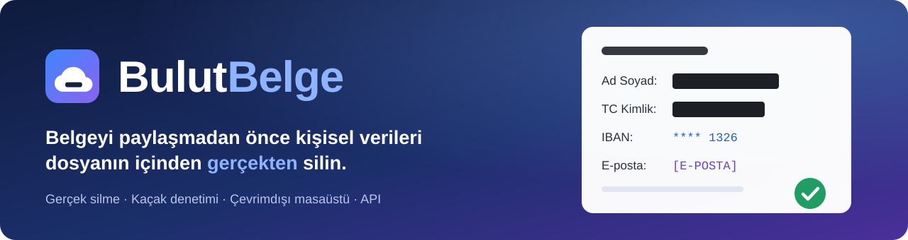

<br>

[](LICENSE)


**[Hızlı başlangıç](#-kurulum)** · **[Kullanım kılavuzu](docs/kullanici/masaustu.md)** · **[Ajan komut satırı](docs/AJAN-KOMUT-SATIRI.md)** · **[Güvenlik](SECURITY.md)** · **[English](#english-summary)**

<br>

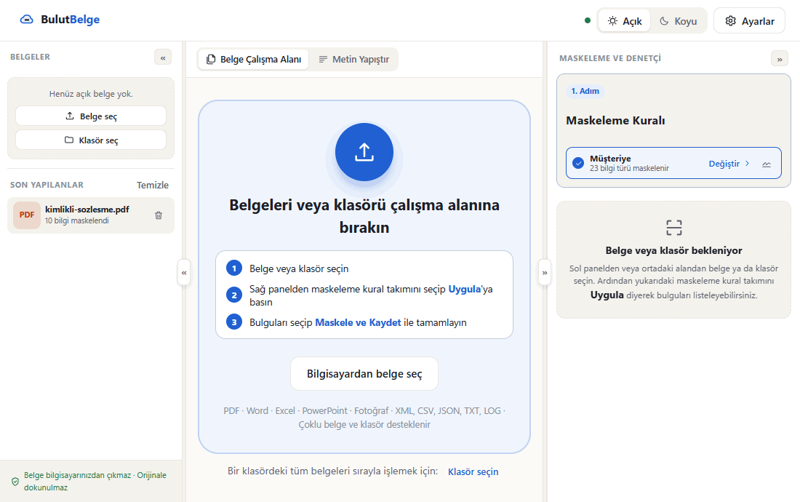

<sub>Gerçek uygulamadan alınmış kısa gösterim. Tüm belgeler sahte örnek verilerle hazırlanmıştır.</sub>

</div>

---

## Sorun: siyah kutu silmez

PDF'te bir verinin üstüne siyah kutu çizmek **metni silmez**. Belgeyi alan kişi metni seçip kopyalayabilir, `Ctrl+F` ile arayabilir ya da dosyanın iç yapısını açıp okuyabilir. Aynısı Word'deki izlenen değişiklikler ve yorumlar, fotoğraftaki konum bilgisi, e-Fatura XML'indeki dijital imza özeti için de geçerlidir.

BulutBelge değeri **dosyadan çıkarır**, sonra kopyayı yeniden okuyup bir şey kalmadığını doğrular.

<table>
<tr>
<td align="center"><b>Önce</b><br><sub>sahte örnek belge</sub></td>
<td align="center"><b>Sonra</b><br><sub>BulutBelge, "Müşteriye" kural takımı</sub></td>
</tr>
<tr>
<td>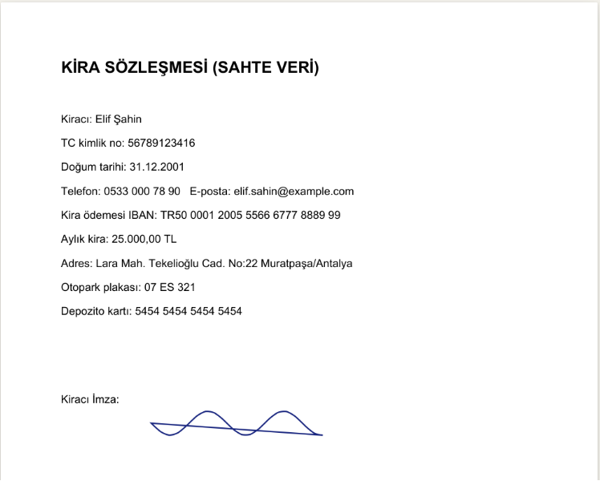</td>
<td>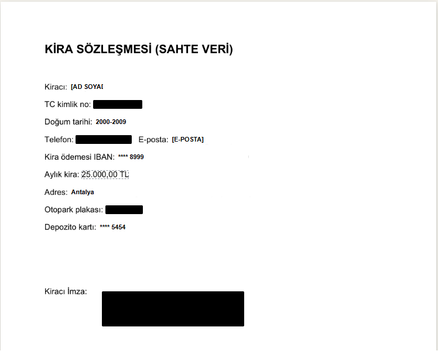</td>
</tr>
</table>

<p align="center"><sub>Ad etiketle değişti, TC kimlik ve telefon karartıldı, IBAN'ın yalnızca son 4 hanesi açık kaldı, imza kaldırıldı.</sub></p>

## Neler sunar?

<table>
<tr>
<td width="33%" valign="top">

### 🔒 Gerçek silme
Değer metin katmanından, piksellerden ve gizli meta veriden çıkarılır. Üstü örtülmez; altında bir şey kalmaz.

</td>
<td width="33%" valign="top">

### 🔎 Kaçak denetimi
Kaydedilen kopya yeniden okunur. Maskelenmesi seçilen bir bilgi hâlâ okunuyorsa **dosya yazılmaz**.

</td>
<td width="33%" valign="top">

### 🎯 Alıcıya göre
Müşteriye, denetçiye, kurum içine ya da bir yapay zekâ aracına giden aynı belge farklı ayrıntı düzeyi ister. 9 hazır kural takımı, istediğinizi de yazarsınız.

</td>
</tr>
<tr>
<td valign="top">

### 📴 Çevrimdışı masaüstü
Belge bilgisayarınızdan çıkmaz. Hesap ve internet istemez. **Belgeyi ve içindeki bilgileri hiçbir yere göndermez.**

</td>
<td valign="top">

### 🧾 34 veri türü
TC kimlik, VKN, MERSİS, IBAN, kart no, telefon, e-posta, ad soyad, adres, doğum tarihi, plaka, imza/kaşe, fotoğraftaki yüz ve daha fazlası.

</td>
<td valign="top">

### 🧩 Tutarlı takma ad
Aynı kişi, aynı kurum her belgede aynı `Kişi-1`, `Kurum-1` adını alır; eşleme tablosu yerelde, şifreli kasada durur.

</td>
</tr>
</table>

### Maskeleme yöntemleri

Aynı değer, seçilen yönteme göre farklı yazılır. Yöntemi her veri türü için ayrı seçersiniz.

| Yöntem | `Elif Şahin` | `TR33 0006 1005 1978 6457 8413 26` | `0532 000 12 34` |
|---|---|---|---|
| **Karartma** | ██████████ | ██████████ | ██████████ |
| **Etiket** | `[AD SOYAD]` | `[IBAN]` | `[TELEFON]` |
| **Baş harfler** | `E. Ş.` | n/a | n/a |
| **Son 4 hane açık** | n/a | `**** 1326` | `**** 12 34` |
| **Takma ad** | `Kişi-1` | `IBAN-1` | `Telefon-1` |
| **Bulanık** | bulanıklaştırılmış alan | bulanıklaştırılmış alan | bulanıklaştırılmış alan |

Takma ad, anonimleştirme değildir; tutarlı bir etiketlemedir ve dilde böyle anlatılır.

### Desteklenen belgeler

| Tür | Biçim |
|---|---|
| PDF | metinli ve taranmış (yerel OCR) |
| Office | Word `.docx` · Excel `.xlsx` · PowerPoint `.pptx` |
| Görsel | `.jpg` `.png` `.tif` `.bmp` `.webp` (OCR ve yüz tespiti) |
| e-Belge | e-Fatura/e-Arşiv UBL `.xml` · UYAP `.udf` · e-posta `.eml` |
| Metin ve veri | `.txt` `.csv` `.tsv` `.log` `.md` `.json` `.ini` `.yaml` `.yml` |
| Arşiv | `.zip` (içindeki desteklenenler tek tek işlenir) |

Eski `.doc`, `.xls`, `.ppt` ve makrolu dosyalar güvenlik gerekçesiyle reddedilir; yeni biçimde kaydedip yeniden deneyin.

---

## 🚀 Kurulum

### Masaüstü uygulaması

<details open>
<summary><b>Windows: kurulum programı</b> (önerilen)</summary>

<br>

Kurulum programı Python, Rust ya da Node gerektirmez; her şey paketin içindedir.

1. Kurulum dosyasını [bulutbelge.com/indir](https://bulutbelge.com/indir) sayfasından indirin (`.exe` kurulum programı ya da `.msi`). İlk sürümün sayfası yayımlanana kadar dosyayı kurumunuzun BT ekibinden alın.
2. İndirdiğiniz dosyayı doğrulayın. Çıkan değer sayfadaki SHA-256 ile aynı olmalı; farklıysa çalıştırmayın:

   ```powershell
   Get-FileHash -Algorithm SHA256 .\BulutBelge_<sürüm>_x64-setup.exe
   ```

3. Çift tıklayıp kurun. Kurulum sırasında **Kullanım Koşulları** gösterilir.
4. İlk açılışta kısa bir **"Başlamadan önce"** penceresi çıkar. Okuyup kabul edince uygulama açılır:

   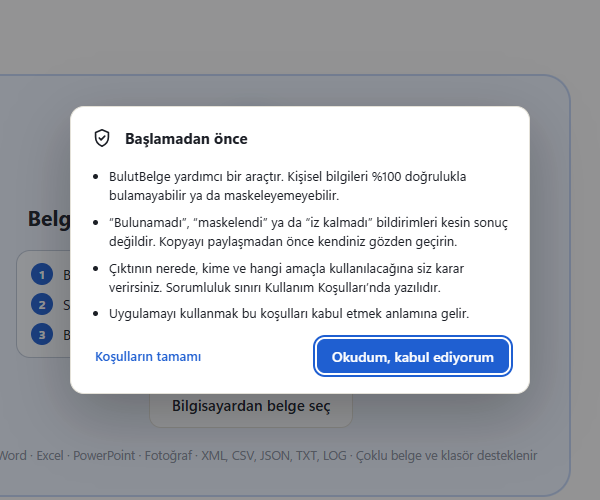

5. **Başlat menüsünden BulutBelge**'yi açın, bir belge ya da klasör seçin.

> Windows kurulum dosyaları henüz kod imzalı değildir. SmartScreen "bilinmeyen yayıncı" uyarısı çıkabilir; imza yayımlanınca bu not kalkacak.

**Komut satırı:** `.exe` kurulum programı `bulutbelge` komutunu da tanımlar. Yeni bir PowerShell açıp `bulutbelge --help` yazın. `.msi` PATH'e dokunmaz.

**Kaldırma:** Ayarlar › Uygulamalar. Belgeleriniz silinmez.

</details>

<details>
<summary><b>Kaynaktan çalıştırmak</b> (geliştiriciler, macOS ve Linux)</summary>

<br>

Gerekenler: [Git](https://git-scm.com), [Node.js LTS](https://nodejs.org), [Python 3.12](https://python.org), [Rust](https://rustup.rs) (Windows'ta Visual Studio C++ Build Tools).

```bash
git clone <depo-adresi>
cd bulutbelge/desktop
npm install
python -m venv engine/.venv
engine/.venv/Scripts/python -m pip install -e "../core[dev]" -e "engine[dev]"   # macOS/Linux: Scripts yerine bin
engine/.venv/Scripts/python engine/tessdata_indir.py                             # yerel OCR dil dosyaları
npm run tauri dev                                                                # Windows: desktop\BASLAT.cmd
```

macOS (`.dmg`) ve Linux (`.deb`) paketleri için `npm run app:build` kullanılır; bu paketler henüz temiz makinede denenmedi.

</details>

#### İlk kullanım (dört adım)

| | |
|---|---|
| **1. Seçin** | Belgeleri ya da klasörü sürükleyin; ya da **Belge seç / Klasör seç** |
| **2. Uygulayın** | Sağ panelde kural takımını seçip **Uygula**'ya basın; tarama sürerken ilerleme görünür |
| **3. İnceleyin** | Bulguları kategori kartlarından açıp kapatın; kaçanı **Alan seç** ya da **Ara ve maskele** ile ekleyin |
| **4. Kaydedin** | **Maskele ve Kaydet**. Orijinale dokunulmaz, yanına `_maskeli` kopya yazılır |

<table>
<tr>
<td width="50%">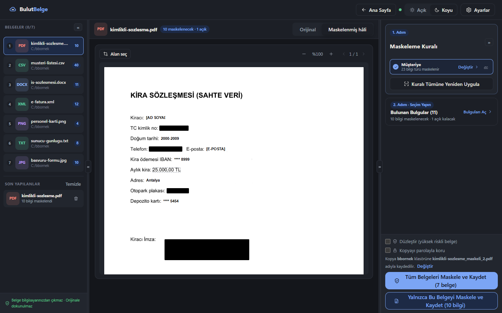<br><sub><b>Koyu tema</b> ile çalışma alanı</sub></td>
<td width="50%">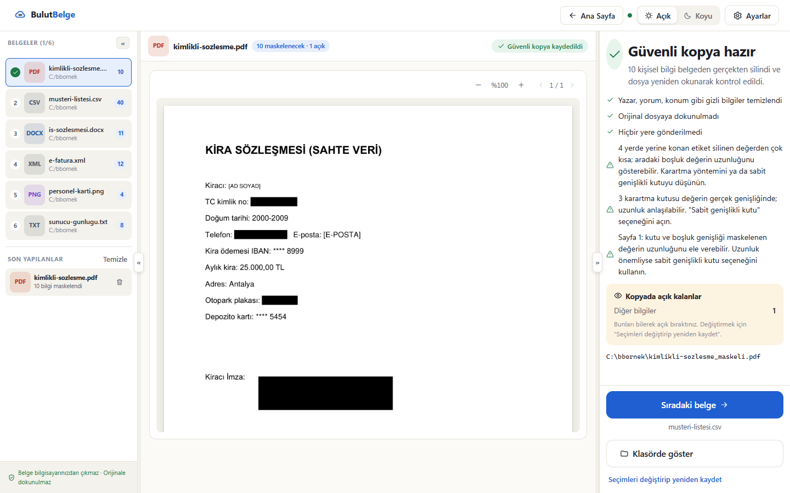<br><sub><b>Güvenli kopya hazır:</b> silinen bilgi sayısı, uyarılar ve kopyanın yolu</sub></td>
</tr>
<tr>
<td>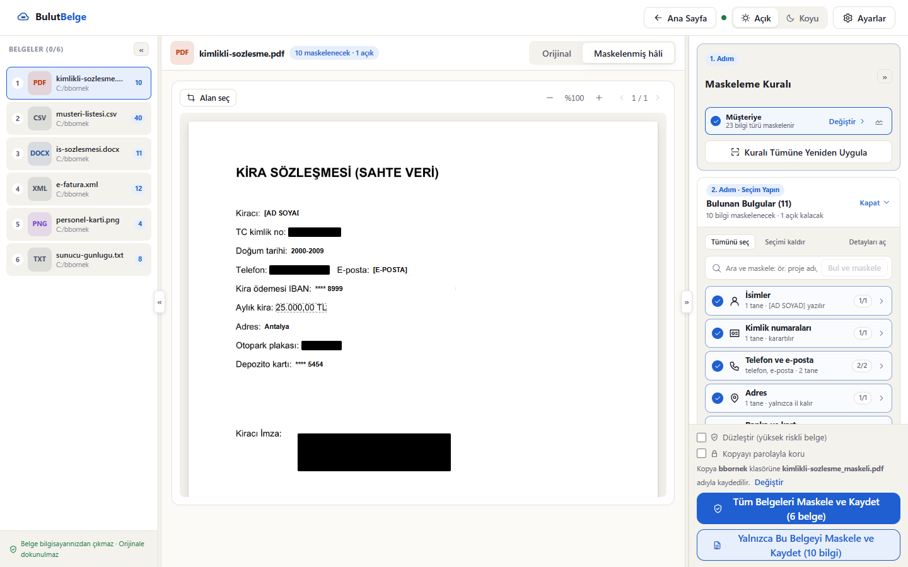<br><sub><b>Bulgular:</b> kategori kartları, Ara ve maskele, kaçak denetimi</sub></td>
<td>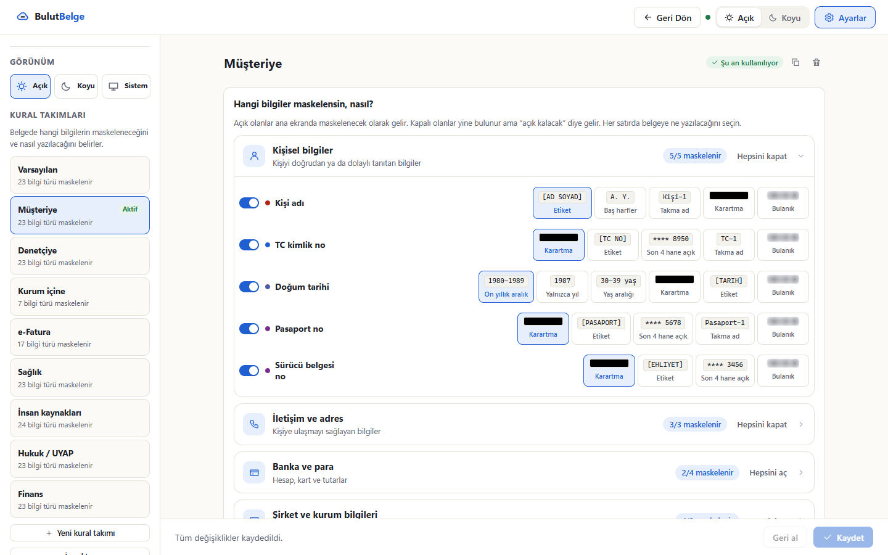<br><sub><b>Ayarlar:</b> her veri türü için ayrı yöntem, kendi kural takımınız</sub></td>
</tr>
</table>

#### Metin yapıştırma, tablolar ve ajanlar

<table>
<tr>
<td width="33%" valign="top">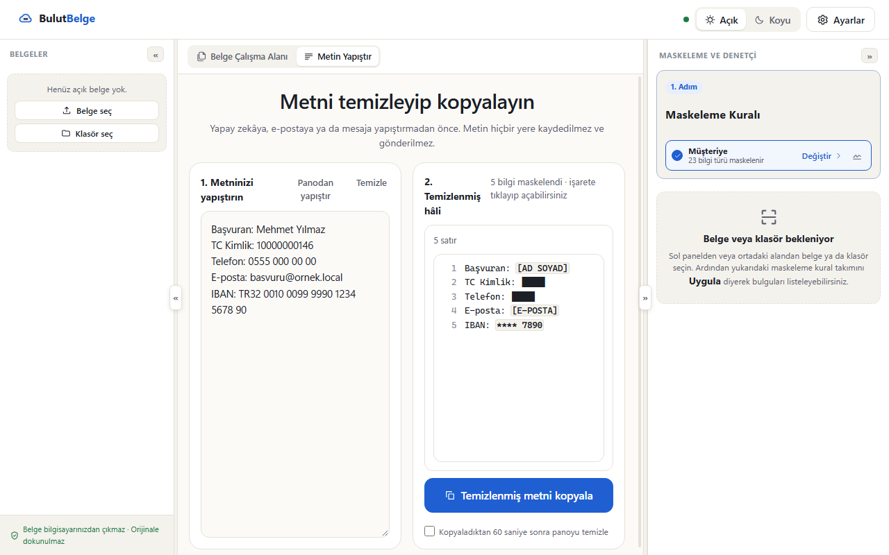<br><sub><b>Metin Yapıştır:</b> dosya olmadan e-posta, not ya da yapay zekâya gidecek metni temizleyip kopyalayın; metin hiçbir yere kaydedilmez</sub></td>
<td width="33%" valign="top">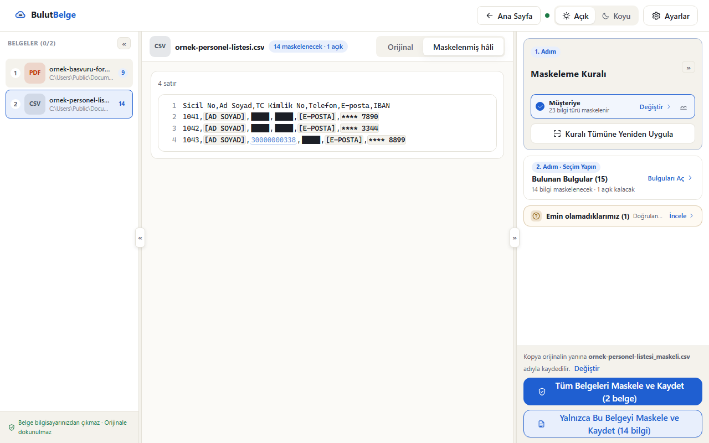<br><sub><b>Tablolar:</b> CSV ve Excel'de sütun başlığına göre maskeleme; yapı ve kodlama korunur</sub></td>
<td width="33%" valign="top">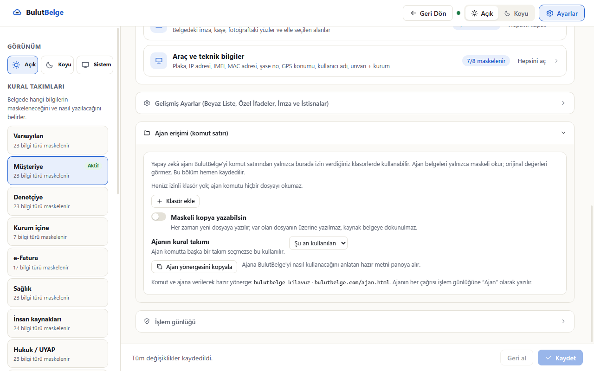<br><sub><b>Ajan erişimi:</b> yapay zekâ ajanı yalnızca izin verdiğiniz klasörlerde, yalnızca maskeli okur</sub></td>
</tr>
</table>

### Yapay zekâ ajanları için komut satırı

Ajanlar yalnızca sizin izin verdiğiniz klasörleri görür ve dosyaları yalnızca maskelenmiş biçimiyle okur. Hazır yönerge: [docs/AJAN-KOMUT-SATIRI.md](docs/AJAN-KOMUT-SATIRI.md).

---

## Nasıl çalışır?

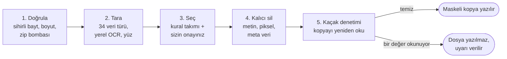

Her adım, biçimin kendi iç yapısında çalışır: PDF içerik akışı ve form alanları, Word'ün XML düğümleri ve izlenen değişiklikleri, Excel'in paylaşılan metinleri, fotoğrafın piksel ve EXIF verisi, e-Fatura'nın imza özeti.

## Masaüstü ve kurumsal sunucu

Bu depo **masaüstü uygulamasını** ve ortak **çekirdeği** içerir. Masaüstü uygulaması belgelerinizi ve içlerindeki bilgileri dışarı göndermez; **kurumsal sunucu ürününe bağlanmaz**. Kurumların kendi altyapısında çalıştırdığı, API anahtarıyla kullanılan **kurumsal sunucu** ürünü ayrıdır ve bu depoda değildir; bilgi için [bulutbelge.com](https://bulutbelge.com).

## Güvenlik ilkeleri

- **Amaç olmadan erişim yok.** Şüphede reddeder. Maske kaldırma insan onayı ve gerekçe ister.
- **Özel ifadeler şifreli kasada durur** (AES-256, parolayla açılır); diske açık yazılmaz.
- **Orijinal değerler diske açık yazılmaz**, raporlara ve günlüğe girmez.
- **Her işlem hash zincirli yerel işlem günlüğüne yazılır**; zincir sonradan bozulursa fark edilir. Günlükte değer ve belge içeriği yoktur.

Bir güvenlik açığı ya da belgeden kişisel veri sızdıran bir maskeleme hatası bulduysanız herkese açık kayıt açmadan önce [SECURITY.md](SECURITY.md) içindeki adrese bildirin. Örnek belge gönderirken **yalnızca sahte veri** kullanın.

## Depo yapısı

| Klasör | İçerik |
|---|---|
| `core/` | Tespit motoru, belge işleyiciler, maskeleme çekirdeği (Python) |
| `desktop/` | Tauri masaüstü uygulaması ve yerel Python motoru |
| `docs/` | Kullanım kılavuzu ve ajan komut satırı belgesi |

## Belgeler

| Okuyucu | Belge |
|---|---|
| Son kullanıcı | [Masaüstü kullanım kılavuzu](docs/kullanici/masaustu.md) |
| Ajan kullanan | [Ajan / komut satırı](docs/AJAN-KOMUT-SATIRI.md) |

## Katkı

Katkılar çekme isteğiyle kabul edilir. İlk katkıdan önce [Katkıcı Lisans Sözleşmesi](CLA.md) (CLA) imzalanır: çekme isteğine "I have read the CLA Document and I hereby sign the CLA" yorumunu yazmanız yeterlidir; bir bot imzayı kaydeder ve bir kez imzalamak sonraki katkıları da kapsar. Sözleşme, katkının telif hakkını size bırakır ve projenin ileride başka lisans koşullarıyla da sunulabilmesini sağlar. Gerçek kişisel veri, parola veya gizli anahtar içeren katkı kabul edilmez; test verisi yalnızca sahte olur.

## Sorumluluk reddi

BulutBelge yardımcı bir araçtır ve %100 doğrulukta çalışmayabilir. Bazı bilgileri gözden kaçırabilir, bazılarını gereğinden fazla maskeleyebilir. Çıktıyı paylaşmadan önce kendiniz kontrol edin. "Bulunamadı", "maskelendi" ya da "iz kalmadı" bildirimleri kesin sonuç değildir. Takma ad, anonimleştirme değildir. Ayrıntı: [kullanım koşulları](https://bulutbelge.com/kosullar.html).

## Lisans

GNU Affero Genel Kamu Lisansı sürüm 3 ([AGPL-3.0](LICENSE)). Üçüncü taraf bileşenlerin lisansları [NOTICE.md](NOTICE.md) içindedir.

----

## English summary

**BulutBelge removes personal data from documents for real, before you share them.** A black box over text in a PDF does not delete it; anyone can still copy, search or extract it. BulutBelge finds the data, masks it according to who will receive the document, physically removes it from the file (text layer, pixels, metadata) and re-reads the saved copy to check that nothing leaked. If a value that should be masked can still be read, the file is not written.

- **Desktop app** (Tauri): works fully offline, never sends documents or personal data anywhere, never touches the original file. Windows installer first; macOS and Linux packages are being prepared.
- A separate **enterprise server** product (API + admin panel, used only through API keys) exists but is not part of this repository.
- **34 data types**, 7 masking methods, 9 built-in rule sets, local OCR and face detection, folder and ZIP batch processing.
- **Formats:** PDF, DOCX, XLSX, PPTX, images, e-invoice XML, UDF, EML, plain-text and data files (`.txt .csv .tsv .log .md .json .ini .yaml .yml`), ZIP.
- The interface ships Turkish and English locales; the product (and, internally, API) documentation sites are available in Turkish and English. Markdown guides in the repository are in Turkish.

Licensed under AGPL-3.0. Security reports: see [SECURITY.md](SECURITY.md). This is an assistive tool and can miss data; always review the output.
