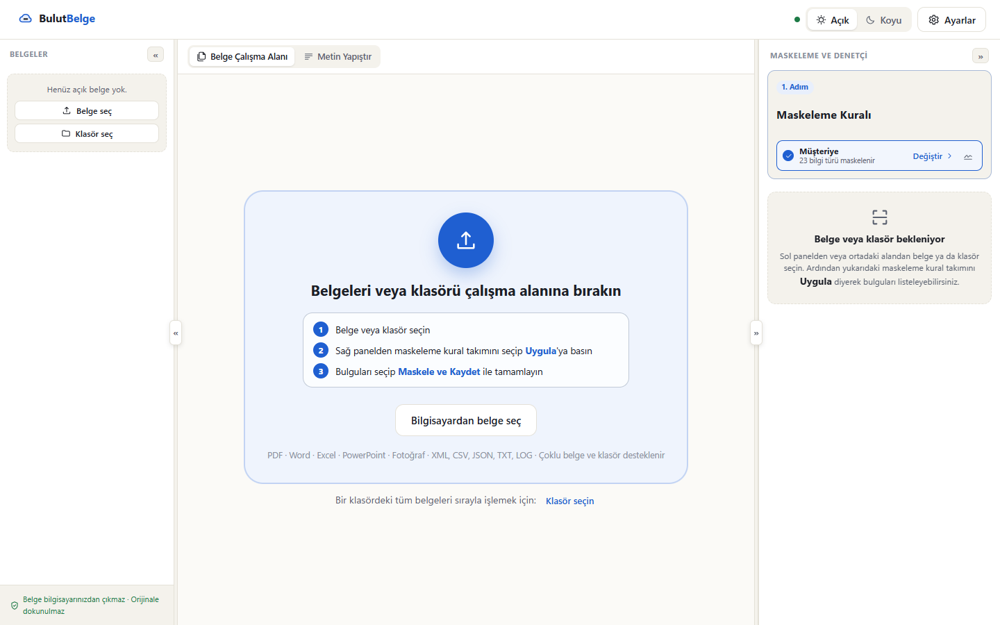
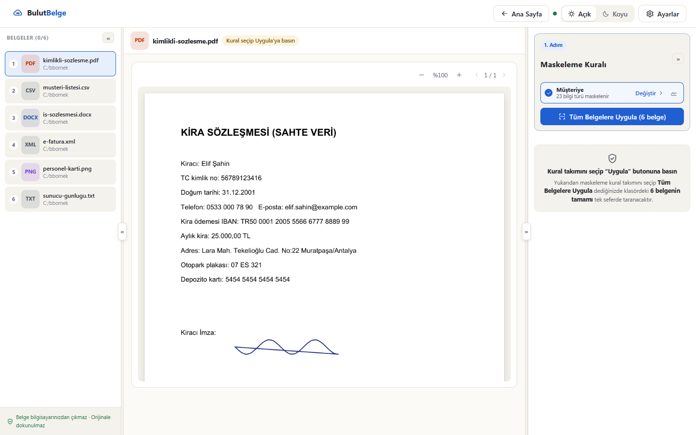
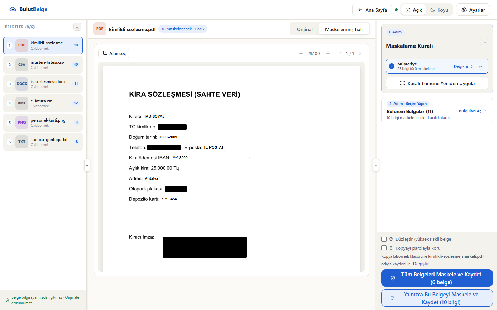
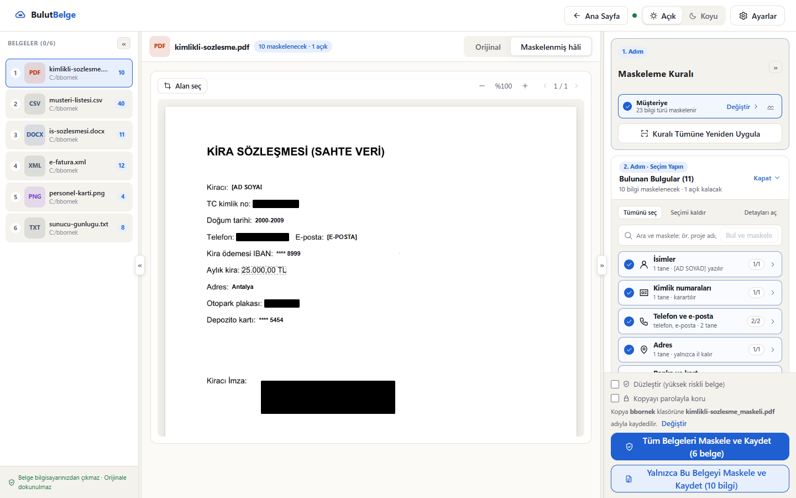
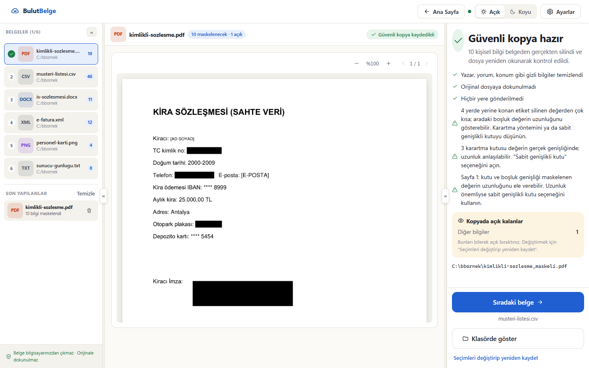
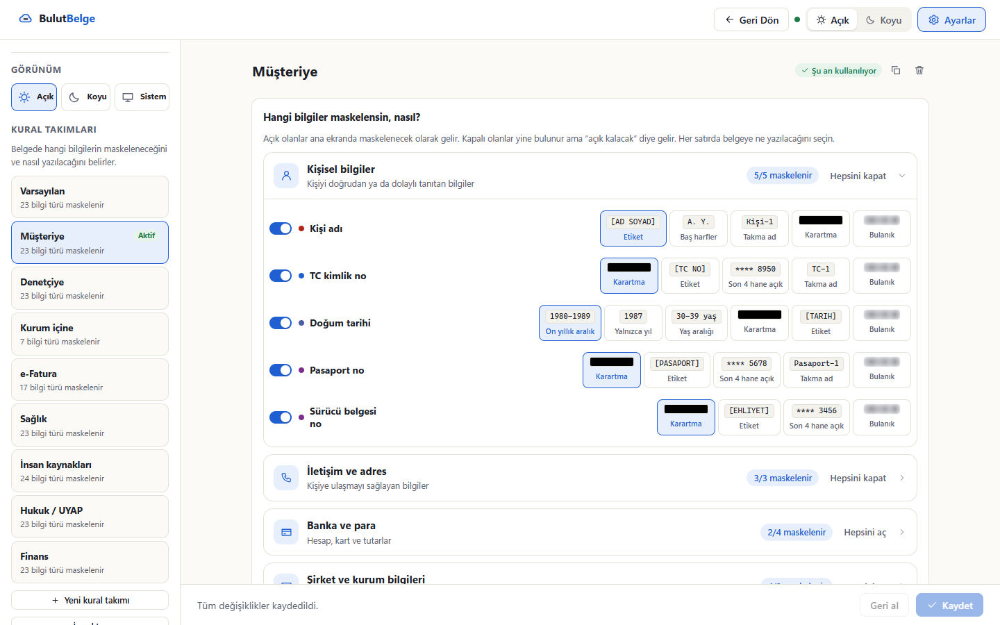

# BulutBelge Masaüstü — Kullanım Kılavuzu

BulutBelge; PDF, Word (`.docx`), Excel (`.xlsx`), PowerPoint (`.pptx`), fotoğraf/görsel (`JPG, PNG, TIFF, BMP, WEBP`), ZIP arşivi (`.zip`) ve metin/veri (`XML` [imzalı e-Fatura UBL dahil], `CSV`, `JSON`, `TXT`, `LOG`, `MD`, `TSV`, `INI`, `YAML`) belgelerindeki kişisel ve ticari verileri (TC kimlik, VKN, MERSİS, ticaret sicil, kurum unvanı, vergi dairesi, IBAN, banka/şube, ETTN/e-imza, telefon, e-posta, ad soyad, adres, tutar, doğum tarihi, plaka, imza/kaşe/QR, fotoğraftaki yüz…) tespit eder, önizlemede size gösterir ve onayınızla **gerçekten silerek** güvenli bir kopya kaydeder.

> **Temel Güvenlik Sözü:** Masaüstü uygulamasında tüm işlemler %100 bilgisayarınızda (çevrimdışı) gerçekleşir; hiçbir belge veya veri dışarıya gönderilmez ve orijinal dosyalarınıza asla dokunulmaz. Masaüstü uygulaması hiçbir API'yi ve kurum sunucusunu kullanmaz, hesap istemez. Kurumlar için ayrı bir sunucu sürümü vardır, masaüstü ona bağlanmaz ([12. bölüm](#12-yönetim-paneli-panelbulutbelgecom)).

---

## İçindekiler

1. [Uygulamayı Kurmak ve Başlatmak](#1-uygulamayı-kurmak-ve-başlatmak)
2. [Stüdyo Ekranını Tanıyalım (3 Panelli Düzen)](#2-stüdyo-ekranını-tanıyalım-3-panelli-düzen)
3. [Adım Adım Belge ve Klasör Maskeleme Akışı](#3-adım-adım-belge-ve-klasör-maskeleme-akışı)
4. [Klasör Ağacı ve Çoklu Belge Senkronizasyonu](#4-klasör-ağacı-ve-çoklu-belge-senkronizasyonu)
5. [Önizleme ve Belge Araçları](#5-önizleme-ve-belge-araçları)
6. [Desteklenen Dosya Biçimleri ve Özellikleri](#6-desteklenen-dosya-biçimleri-ve-özellikleri)
7. [Kural Takımları ve Ayarlar](#7-kural-takımları-ve-ayarlar)
8. [Takma Ad (Kişi-1) ve Şifreli Kasa](#8-takma-ad-kişi-1-ve-şifreli-kasa)
9. [Uygulama Neyi Garanti Eder, Neyi Etmez?](#9-uygulama-neyi-garanti-eder-neyi-etmez)
10. [Örnek Test Belgeleriyle Deneme](#10-örnek-test-belgeleriyle-deneme)
11. [Sık Karşılaşılan Sorunlar ve Çözümleri](#11-sık-karşılaşılan-sorunlar-ve-çözümleri)
12. [Yönetim Paneli (panel.bulutbelge.com)](#12-yönetim-paneli-panelbulutbelgecom)
13. [Uygulamayı Kaldırmak](#13-uygulamayı-kaldırmak)

---

## 1. Uygulamayı Kurmak ve Başlatmak

### 1.1 Kurulum programı ile (önerilen)

Kurulum programı Python, Rust ya da Node gerektirmez; her şey paketin içindedir.

1. Kurulum dosyasını [bulutbelge.com/indir](https://bulutbelge.com/indir) sayfasından indirin (Windows için `.exe` kurulum programı ya da `.msi`).
2. İndirdiğiniz dosyanın özetini sayfadaki SHA-256 ile karşılaştırın (PowerShell: `Get-FileHash -Algorithm SHA256 .\<dosya>`). Özet farklıysa dosyayı çalıştırmayın.
3. Çift tıklayıp kurun. Kurulum sırasında **Kullanım Koşulları** gösterilir. İlk açılışta kısa bir **"Başlamadan önce"** penceresi çıkar; okuyup kabul edince uygulama açılır.
4. Başlat menüsünden **BulutBelge**'yi açın.

> **Not:** Windows kurulum dosyaları henüz kod imzalı değildir; SmartScreen "bilinmeyen yayıncı" uyarısı çıkabilir (imza yayımlanınca bu not kalkacak). İlk sürümün indirme sayfası yayımlanana kadar kurulum dosyasını kurumunuzun BT ekibinden alın.

**Komut satırı (ajanlar ve otomasyon için):** `.exe` kurulum programı `bulutbelge` komutunu da tanımlar. Yeni bir PowerShell açıp `bulutbelge --help` ya da `bulutbelge kilavuz` yazın. `.msi` PATH'e dokunmaz; komutu `C:\Program Files\BulutBelge\engine\bulutbelge-engine.exe` ile çalıştırın. Ayrıntı: `docs/AJAN-KOMUT-SATIRI.md`.

**Kaldırma:** Ayarlar › Uygulamalar'dan kaldırın. Belgeleriniz ve ayarlarınız silinmez; ayarlar kullanıcı klasörünüzde kalır.

### 1.2 Kaynaktan çalıştırmak (geliştiriciler)

Aşağıdaki adımlar yalnızca uygulamayı geliştirmek ya da denemek isteyenler içindir.

#### Gerekli Programlar

| Program | Ne İşe Yarar | Windows | macOS |
|---|---|---|---|
| **Git** | Kodu indirmek ve güncellemek | `git-scm.com` | `xcode-select --install` |
| **Node.js (LTS)** | Arayüz paketlerini kurar ve başlatır | `nodejs.org` | `brew install node` |
| **Python 3.12** | Belgeleri okuyan ve maskeleyen yerel motor | `python.org` | `brew install python@3.12` |
| **Rust** | Masaüstü penceresini (Tauri) derler | `rustup.rs` + VS C++ Build Tools | `rustup.rs` |

#### İlk Kurulum (Bir Kez Yapılır)

**Windows (PowerShell / CMD):**
```bash
git clone <depo-adresi>
cd bulutbelge/desktop
npm install
python -m venv engine/.venv
engine/.venv/Scripts/python -m pip install -e "../core[dev]" -e "engine[dev]"
engine/.venv/Scripts/python engine/tessdata_indir.py
```

**macOS / Linux (Terminal):**
```bash
git clone <depo-adresi>
cd bulutbelge/desktop
npm install
python3.12 -m venv engine/.venv
engine/.venv/bin/python -m pip install -e "../core[dev]" -e "engine[dev]"
engine/.venv/bin/python engine/tessdata_indir.py
```

#### Uygulamayı Açmak

- **Windows'ta:** `desktop\BASLAT.cmd` dosyasına çift tıklayın.
- **Terminalden (macOS / Windows):**
  ```bash
  cd bulutbelge/desktop
  npm run tauri dev
  ```

---

### 1.3 Hazır Kurulum Paketi (Windows): Hangi Paket Kime?

Hazır kurulum dosyasını kullanacaksanız (yukarıdaki geliştirici kurulumu gerekmez) iki paketten birini seçin:

| Paket | Kime | Not |
|---|---|---|
| Normal (`...-setup.exe`, `....msi`) | İnternet erişimi olan bilgisayarlar | Küçüktür. WebView2 çalışma ortamı bilgisayarda yoksa kurulum sırasında Microsoft'tan indirilir. |
| Çevrimdışı (`...-cevrimdisi` ekli dosyalar) | İnternet erişimi olmayan kurumlar | Yaklaşık 170 MB daha büyüktür. WebView2 paketin içindedir, indirme gerekmez. |

**WebView2 notu:** Uygulama penceresi Microsoft WebView2 ile çalışır. Windows 10 ve 11'in güncel sürümlerinde zaten kuruludur; normal paket yalnızca eksikse indirir. İnternetsiz ve WebView2'si olmayan bir bilgisayarda normal paket kurulumu tamamlayamaz, çevrimdışı paketi kullanın.

---

## 2. Stüdyo Ekranını Tanıyalım (3 Panelli Düzen)

Uygulama, tüm işlemlerin tek ekranda rahatça yönetilebildiği **3 panelli Stüdyo** arayüzüyle çalışır. Aşağıda açılış ekranı (sol: belgeler, orta: çalışma alanı, sağ: kural ve denetçi):



Bu ekran görüntüleri tamamen sahte örnek belgelerle alınmıştır.

| Bölge | İçerik ve Görevleri | Boyutlandırma |
|---|---|---|
| **Üst Çubuk** | Sol tarafta `BulutBelge` logosu; sağ tarafta **`← Ana Sayfa`** (açık belge varken başlangıca döner), motor durum ışığı (yeşil nokta) ve **`Ayarlar`** butonu. | Sabit üst bar |
| **1. Sol Panel (`Belgeler ve Kural Bilgisi`)** | • **Belgeler & Klasör Ağacı:** Seçilen tekil belgeler veya klasördeki alt klasör/belge yapısı.<br>• **Sayfa Gezgini:** Çok sayfalı PDF ve sunumlarda sayfalar arası hızlı geçiş ve sayfa çıkarma.<br>• **Son yapılanlar (Sol Alt):** Daha önce maskelediğiniz belgelerin kısa listesi; satırdaki çöp kutusu kaydı listeden siler (dosyaya dokunmaz). | Kenar çizgisinden **sürükleyerek genişletilebilir/daraltılabilir** veya **`«`** butonuyla tamamen gizlenebilir. |
| **2. Orta Panel (`Çalışma Alanı ve Belge Önizleme`)** | • Belge seçilmeden önce: **Belge Çalışma Alanı** (sürükle-bırak) ve **Metin Yapıştır** sekmeleri.<br>• Belge seçildikten sonra: Üst araç çubuğunda dosya adı, **`Orijinal / Maskelenmiş hâli`** görünüm anahtarı, **`Belge seç`** / **`Klasör seç`** butonları; ortada ise yakınlaştırılabilir belge önizlemesi. | Sol ve sağ paneller daraltıldığında otomatik genişler. |
| **3. Sağ Panel (`Denetçi: 1. Adım ve 2. Adım`)** | • **1. Adım — Maskeleme Kuralı:** Kural takımını seçip **`Uygula`** (`Tüm Belgelere Uygula`) butonuna basma alanı.<br>• **2. Adım — Seçim Yapın (Bulgular):** Taranan belgedeki bulgu kategorileri, kişi adları, **Ara ve maskele** kutusu, uyarılar ve en altta **`Maskele ve Kaydet`** (`Tüm Belgeleri Maskele ve Kaydet`) butonu. | Kenar çizgisinden **sürükleyerek genişletilebilir/daraltılabilir** veya **`»`** butonuyla gizlenebilir. |

---

## 3. Adım Adım Belge ve Klasör Maskeleme Akışı

BulutBelge **körlemesine otomatik maskeleme yapmaz**; her zaman şu 4 adımı izler:

### Adım 1: Belge veya Klasör Seçin
- Orta alandaki kutuya belge/klasör sürükleyin ya da sol/orta paneldeki **`Belge seç`** veya **`Klasör seç`** butonuna tıklayın.
- Belge hemen orta ekranda **orijinal haliyle** açılır (henüz taranmamıştır). Klasör seçtiyseniz klasörün içindeki tüm desteklenen belgeler sol panelde klasör ağacı olarak listelenir.



### Adım 2: Maskeleme Kuralını Seçip "Uygula"ya Basın
- Sağ paneldeki **`1. Adım — Maskeleme Kuralı`** kartından kullanmak istediğiniz kural takımını seçin:
  - **Varsayılan**
  - **Müşteriye** *(Kişiyi tanıtan her şey maskelenir)*
  - **Denetçiye** *(Baş harfler, son 4 hane, il/ilçe gibi iz sürülebilir kısmi maskeleme)*
  - **Kurum içine** *(Yalnızca kimlik ve banka/hesap numaraları maskelenir)*
  - **e-Fatura** *(GİB e-Fatura/e-Arşiv PDF, imzalı UBL XML ve `.zip` paketleri için: alıcı/satıcı kurum unvanı, adres, vergi dairesi, VKN/TCKN, MERSİS, ticaret sicil, banka/IBAN, tutar, ETTN/e-imza ve QR karekod maskelenir)*
- **`Uygula`** (klasör/çoklu belgede **`Tüm Belgelere Uygula (N belge)`**) butonuna basın. Tarama sürerken ortada belge animasyonu ve (çoklu belgede) ilerleme şeridi görünür.
- Uygulama seçilen kuralı sıradaki tüm belgelere tek seferde uygular ve kişisel verileri tarar.



### Adım 3: Bulguları İnceleyin ve Seçim Yapın (`2. Adım — Seçim Yapın`)
- Tarama bittiğinde sağ panelde **`2. Adım — Seçim Yapın`** bölümü açılır ve orta ekranda belgenin **`Maskelenmiş hâli`** gösterilir.
- **Kategori Kartları (`İsimler`, `Kimlik numaraları`, `Telefon ve e-posta`, `Adres`…):**
  - Mavi tikli olanlar maskelenecek, boş olanlar açık bırakılacaktır.
  - Bir kategorinin sağındaki oka tıklayarak içindeki tekil bulguları (veya kişi isimlerini) ayrı ayrı açıp kapatabilirsiniz.
- **Ara ve Maskele:** Sağ paneldeki arama kutusuna belgede maskelenmesini istediğiniz özel bir kelime/proje adı yazıp **`Bul ve maskele`**'ye basabilirsiniz.
- **Elle Alan Seç (`Alan seç`):** PDF veya fotoğrafta otomatik bulunamayan bir imza, kaşe veya bölge varsa önizleme üstündeki **`Alan seç`** butonuyla fareyle dikdörtgen çizerek maskeye ekleyebilirsiniz.



### Adım 4: Maskele ve Kaydet
- Sağ alt köşedeki:
  - **`N bilgiyi maskele ve kaydet`**: Yalnızca o an ekranda açık olan belgeyi maskeleyip kaydeder.
  - **`Tüm Belgeleri Maskele ve Kaydet (N belge)`**: Klasördeki/sıradaki tüm belgeleri seçimlerinizle tek seferde maskeleyip güvenli kopyalarını (`_maskeli` ekiyle) kaydeder.

Kaydetme bitince sağ panelde **Güvenli kopya hazır** özeti açılır: kaç bilginin silindiği, dosyanın yeniden okunarak denetlendiği, varsa uyarılar (ör. kutu genişliğinin değerin uzunluğunu ele verebileceği), kopyanın tam yolu, **Sıradaki belge** ve **Klasörde göster** düğmeleri. Kopyayı değiştirmek için **Seçimleri değiştirip yeniden kaydet**'e basın.



Kopya seçtiğiniz yerden ya da addan farklı kaydedildiyse **Kaydedildi** ekranında sarı bir not nedenini söyler. Örneğin seçtiğiniz adda bir dosya varsa uygulama o dosyanın üzerine yazmaz, kopyayı `_2` gibi yeni bir adla kaydeder. Klasöre yazma izni yoksa (Mac'te Sistem Ayarları › Gizlilik ve Güvenlik › Dosyalar ve Klasörler) hata mesajı bunu söyler.

---

## 4. Klasör Ağacı ve Çoklu Belge Senkronizasyonu

Bir klasör seçtiğinizde BulutBelge klasörü kör bir toplu işlem ekranına atmak yerine doğrudan **Stüdyo** çalışma alanına yükler:

1. **Hiyerarşik Klasör Ağacı:**
   - Seçilen ana klasörün içindeki doğrudan belgeler **`Ana Klasördeki Belgeler`** altında, alt klasörler ise (`01-Insan-Kaynaklari`, `2026-Ise-Giris` vb.) kendi klasör başlıkları altında girintili olarak gösterilir.
   - Her klasör başlığına tıklayarak o alt klasörü açıp kapatabilir, üstteki **`Daralt / Aç`** butonuyla tüm ağacı tek tıkla yönetebilirsiniz.
2. **Klasör Genelinde Ortak Seçim Senkronizasyonu:**
   - Klasördeki 20 belgede tek tek aynı ayarı yapmanız gerekmez!
   - Bir belgede bir kategoriyi (ör. `Telefon ve e-posta`) veya bir kişi adını (ör. `Zeynep Kaya`) maskelediğinizde ya da açtığınızda, bu tercihiniz **klasördeki diğer tüm belgelere otomatik olarak yansır**.
   - Aynı şekilde **Ara ve maskele** ile eklediğiniz bir sözcük klasördeki tüm belgelerde aranıp maskelenir.

---

## 5. Önizleme ve Belge Araçları

| Araç | Konumu | Açıklama |
|---|---|---|
| **`Orijinal` / `Maskelenmiş hâli`** | Orta üst araç çubuğu | Belgenin orijinal hali ile maskelendiğinde nasıl görüneceği arasında anında geçiş yapar. |
| **`− %100 +`** | Belge önizleme üst çubuğu | Belgeyi yakınlaştırır veya uzaklaştırır; yüzde değerine tıklayınca sayfaya sığdırır. |
| **`Alan seç`** | PDF ve fotoğraf önizlemesi | Fareyle kutu çizerek imza, kaşe veya özel alanı karartmaya ekler. |
| **`Bu sayfayı kopyadan çıkar`** | PDF önizlemesi ve sol Sayfa Gezgini | Kimlik fotokopisi gibi tamamen çıkarılması gereken sayfaları kaydedilecek PDF kopyasından siler. |
| **`Kopyayı parolayla koru`** | Sağ alt kaydetme alanı (PDF) | Kaydedilen PDF kopyasını AES-256 parolasıyla şifreler. |
| **Word önizlemesi** | Orta panel (`.docx`) | Belge Word'deki gibi çizilir ama uygulamadan yalıtılmıştır: belgenin stilleri uygulamanın görünümünü değiştiremez, belgedeki bağlantılar önizlemede tıklanmaz (adres açılmaz). |
| **`Metin Yapıştır`** | Ana ekran üst sekmesi | Dosya olmadan e-posta, not veya ChatGPT/Claude'a gönderilecek metinleri bellekte temizleyip panoya kopyalar. |

---

## 6. Desteklenen Dosya Biçimleri ve Özellikleri

| Biçim | Uzantılar | Nasıl Maskelenir ve Neler Temizlenir? |
|---|---|---|
| **PDF (Metinli & Taranmış)** | `.pdf` | Metin katmanından karakterler kalıcı olarak silinir; taranmış sayfalar yerel OCR ile okunup pikselleri silinir. Yazar, yorum, form alanı, gömülü ek ve JavaScript temizlenir. |
| **Word** | `.docx` | Yazı tipi, tablolar ve paragraf düzeni korunarak maskelenir. İzlenen değişiklikler (track changes), yorumlar, yazar bilgisi ve `mailto:` bağlantıları temizlenir. |
| **Excel** | `.xlsx` | Tüm çalışma sayfaları, sayısal hücreler ve hücre yorumları taranır; tablo yapısı korunur. |
| **PowerPoint** | `.pptx` | Tüm slaytlar, şekiller, tablolar ve konuşmacı notları taranır; slayt tasarımı korunur. |
| **Fotoğraf ve Görsel** | `.jpg`, `.jpeg`, `.png`, `.tif`, `.tiff`, `.bmp`, `.webp` | Yazılar yerel OCR ile okunur, **fotoğraftaki yüzler** otomatik tespit edilip maskelenir; EXIF/GPS konum ve cihaz meta verileri tamamen silinir. Çok sayfalı görsel (TIFF, WEBP) en çok 1000 kare ve kareler toplamında 1 milyar piksel olabilir (300 dpi'lık A4 taramasında yaklaşık 115 sayfa); aşan dosya güvenlik nedeniyle açılmaz. Bu sınır ZIP, e-posta ve Office içindeki görseller için de geçerlidir. |
| **Yapısal Metin ve e-Fatura** | `.xml` (imzalı UBL e-Fatura), `.csv`, `.txt`, `.log`, `.md`, `.json`, `.tsv`, `.ini`, `.yaml`, `.yml` | XML etiket yapısı, CSV sütun yapısı ve karakter kodlaması (`UTF-8`, `Windows-1254`) bozulmadan yalnızca kişisel ve ticari veriler maskelenir; GİB e-Fatura içindeki alıcı/satıcı unvanı, VKN, MERSİS, banka, tutar, ETTN, XAdES dijital imza özeti (`DigestValue`, `SignatureValue`, `X509Certificate`) ve gömülü `base64` PDF/XSLT temizlenir. |
| **E-posta** | `.eml` | Başlıklar (Kimden, Kime, Konu…) ve metin/HTML gövde maskelenir, MIME yapısı korunur. Ekler kendi biçimlerinin kurallarıyla maskelenir; taranamayan ekler kopyadan silinir, ek adları `ek_N.uzantı` olur. Outlook `.msg` desteklenmez. |
| **UYAP Belgesi** | `.udf` | Metin uzunluğu korunarak maskelenir (her karakter `█` olur), böylece paragraf ve tablo düzeni bozulmaz; etiket ya da takma ad seçilse de UDF'de karartma uygulanır. Belge özellikleri (yazar, kurum, belge no) boşaltılır; elektronik imza (`sign.sgn`) içerik değiştiği için çıkarılır. |
| **ZIP Arşivi (Paket)** | `.zip` | Arşiv içindeki tüm desteklenen belgeler (ör. toplu UBL `.xml` / `.pdf` e-Faturalar) açılıp ayrı ayrı maskelenir ve yeni `.zip` olarak kaydedilir; iç dosya adlarındaki ETTN UUID ve kişi adları da maskelenir. Zip bombası, güvensiz `../` yollar ve desteklenmeyen dosyalar reddedilir / güvenlik için çıktıya alınmaz. |

---

## 7. Kural Takımları ve Ayarlar

Sağ üstteki **`Ayarlar`** butonuna tıklayarak kural takımlarını ve uygulama görünümünü yönetebilirsiniz:

- **Sol Sütun (`Kural Takımları` ve `Görünüm`):**
  - Hazır kural takımları (`Varsayılan`, `Müşteriye`, `Denetçiye`, `Kurum içine`, `e-Fatura`) arasında geçiş yapabilir veya **`+ Yeni kural takımı`** ile kuruma özel yeni bir takım oluşturabilirsiniz (toplam `29` yapılandırılabilir veri türü; dahili özel ifade ve özel kalıplarla `31` tanım).
  - Alt kısımdan uygulama temasını **`Açık`**, **`Koyu`** veya **`Sistem`** olarak değiştirebilirsiniz.


- **Sağ Ana Alan (`Hangi bilgiler maskelensin, nasıl?`):**
  - 6 ana bilgi grubu (*Kişisel bilgiler, İletişim ve adres, Banka ve para, Şirket ve kurum bilgileri, İmza/kaşe ve görseller, Araç ve teknik bilgiler*) altında her veri türünü açıp kapatabilir ve maskeleme yöntemini (`Karartma`, `Etiket`, `Baş harfler`, `Son 4 hane açık`, `Yalnızca il / İl ve ilçe`, `Takma ad`, `Bulanık`) tek tıkla seçebilirsiniz.
- **Gelişmiş Ayarlar (Alt Bölüm):**
  - Sayfanın altındaki **`Gelişmiş Ayarlar`** başlığına tıklayarak **Beyaz Liste** (asla maskelenmeyecek kurum adı/e-postası), **Özel İfadeler Kasası**, **İmza ve Kaşe Etiketleri**, **Özel Kalıplar (Regex)** ve **Hiç Maskelenmeyenler** ayarlarına ulaşabilirsiniz.
- Yaptığınız değişiklikleri kaydetmek için sağ alttaki **`Kaydet`** butonuna basın.
- **Excel'de satır ya da sütunun tamamını maskelemek:** "Uygula"dan sonra tablo önizlemesinde sütun harfine (A, B, C…) ya da satır numarasına tıklayın; o sütunun ya da satırın bütün dolu hücreleri "Elle seçilen alan" olarak maskelenir (önizlemede görünmeyen satırlar dahil). Tablonun üstünde seçtiğiniz satır ve sütunlar listelenir; her birinin yanından yöntemi seçebilirsiniz: Karartma, Etiket, Son 4 hane açık, Baş harfler ya da Takma ad (aynı değer her yerde aynı "Değer-3" olur; kasanın açık olması gerekir). Bir hücre hem seçilen satırda hem seçilen sütundaysa daha sıkı yöntem uygulanır. İkinci tıklama ya da listedeki × seçimi kaldırır. Değer ve formül dosyadan gerçekten silinir. O hücrelere başvuran formüllerin son hesaplanan değerleri başka hücrelerde kalabilir; uygulama bunu uyarır.
- **Ajan erişimi (Alt Bölüm):** Yapay zekâ ajanının BulutBelge'yi komut satırından kullanabileceği klasörleri, maskeli kopya yazma iznini ve ajanın kural takımını buradan belirlersiniz. Bu bölüm `Kaydet` beklemeden hemen kaydedilir. Ayrıntı ve ajana verilecek hazır yönerge: `docs/AJAN-KOMUT-SATIRI.md`.
- **Hakkında ve koşullar (Alt Bölüm):** Kullanım koşullarının özeti, tam metnin bağlantısı ve **`Kullanım kılavuzu`** bağlantısı (bu belge; bulutbelge.com/belgeler sayfası tarayıcıda açılır, uygulama hiçbir veri göndermez).
- **İşlem günlüğü (Alt Bölüm):** Uygulamadan ya da ajandan önizlenen, taranan, maskelenen ve dışa aktarılan her belge ile her takma ad geri çevirme (maske kaldırma) tarih, dosya, işlem ve çağırana göre süzülerek listelenir. **`Zinciri denetle`** sonradan değiştirilen ya da silinen kaydı bulur; **`CSV olarak dışa aktar`** süzülen kayıtları Excel'de açılabilir dosyaya yazar. Günlükte bulunan değerler ve belge içeriği yoktur, yalnızca tür bazında sayılar; dosya yolları ise yer alır.

---

## 8. Takma Ad (`Kişi-1`) ve Şifreli Kasa

- **Özel İfadeler Kasası:** Kurumunuza özel müşteri, kişi veya gizli proje adlarını **AES-256** ile şifrelenmiş yerel kasada saklayabilirsiniz.
- **Tutarlı Takma Ad (`Kişi-1`, `TC-1`, `Kurum-1`, `ETTN-1`):** Bir veri türünün yöntemini `Takma ad` yaptığınızda, aynı kişi veya kurum/fatura verisi belgenin her yerinde ve farklı belgelerde tutarlı olarak aynı takma adı alır (ör. `Ayşe Yılmaz` → her yerde `Kişi-1`, VKN → `VKN-1`, tutar → `Tutar-1`, fatura ETTN → `ETTN-1`).
- Eşleme tablosu yalnızca şifreli kasada tutulur; yetkili kişi **Ayarlar → Gelişmiş Ayarlar → Takma adlar** bölümünden kasa kilidini açarak `Kişi-1` kodunun gerçek değerini sorgulayabilir.

---

## 9. Uygulama Neyi Garanti Eder, Neyi Etmez?

### Garanti Ettikleri
- **Gerçek Silme:** Değerlerin üzerini yalnızca siyah kutuyla örtmez; altındaki metni, pikseli ve gizli meta veriyi dosyadan kalıcı olarak çıkarır.
- **Kaçak Tespiti (Son Kontrol):** Kaydedilen her kopya motor tarafından yeniden okunur; maskelenmesi seçilen bir bilgi çıktıda hâlâ okunabiliyorsa dosya **yazılmaz** ve uyarı verilir.
- **Orijinal Dosya Güvenliği:** Orijinal belgelere hiçbir zaman dokunulmaz; her zaman yeni bir `_maskeli` kopya üretilir.

### Sizin Kontrolünüz Gereken Noktalar
- Taranmış eğri/bulanık belgelerde veya standart dışı yazılmış isimlerde OCR/otomatik tespit bazı yerleri kaçırabilir. Kaydetmeden önce **`Maskelenmiş hâli`** önizlemesini gözden geçirin; kaçan bir alan varsa **`Alan seç`** veya **`Ara ve maskele`** ile ekleyin.

---

## 10. Örnek Test Belgeleriyle Deneme

Masaüstünüzdeki **`BulutBelge-Test-Belgeleri`** klasörü (veya `core/tools/ornek_veri_uret.py` aracı) tamamen sahte verilerle üretilmiş zengin bir test seti içerir:
- Ana klasördeki doğrudan belgeler (`genel-mudurluk-duyurusu.docx`, `kurumsal-iletisim-rehberi.csv`, `proje-ozet-raporu.txt`)
- Alt klasörler (`01-Insan-Kaynaklari`, `02-Muhasebe-ve-Finans`, `03-Hukuk-ve-Sozlesmeler`, `04-BT-ve-Loglar`) ve bunların altındaki 2. seviye alt klasörler.

Uygulamada **`Klasör seç`** diyerek `BulutBelge-Test-Belgeleri` klasörünü seçip tüm akışı güvenle test edebilirsiniz.

---

## 11. Sık Karşılaşılan Sorunlar ve Çözümleri

| Sorun / Uyarı | Çözüm |
|---|---|
| **`Port 1420 is already in use`** | Uygulama zaten arka planda çalışıyordur. Açık olan BulutBelge penceresini kullanın veya önceki terminali kapatıp yeniden başlatın. |
| **`OCR dil dosyaları kurulu değil`** | `engine/.venv/bin/python engine/tessdata_indir.py` (Windows'ta `Scripts\python`) komutunu çalıştırın. |
| **`Kaçak tespiti … Dosya yazılmadı`** | Maskelenmesi seçilen bir değer dosyanın iç yapısında kaldığı için güvenlik gereği çıktı engellenmiştir. |
| **`Takma ad yöntemi için kasanın kilidini açın`** | Ayarlar → Gelişmiş Ayarlar → Özel ifadeler bölümünden kasa parolanızı girerek kilidi açın. |

---

## 12. Yönetim Paneli (panel.bulutbelge.com)

> Bu bölüm masaüstü uygulaması için değil, kurumun kendi sunucu sürümü içindir (şu an yalnızca Proteksistem içi test ve geliştirme). Masaüstü uygulaması dosyayı dışarı göndermez, hiçbir API'yi kullanmaz ve yönetim paneline bağlanmaz. Yönetim paneli, sunucu sürümündeki işlemleri izlemek ve ayarları görmek içindir.
>
> Sunucudaki işlemler kullanıcı girişi (Authentik OIDC veya yerel kullanıcı) ve yöneticinin açtığı API anahtarlarıyla (`bb_`) yetkilendirilir; panel yalnızca ofis ağından açılır. 16 Kasım 2026 kararı gereği orijinal belgeler ve sayfa önizlemeleri sunucuda saklanmaz; yalnızca geçici maskeli çıktı (en fazla `60 dk`), çift yönlüyse şifreli eşleme (`esleme.enc`) ve PostgreSQL maskeleme kaydı (dosya adı olmadan) tutulur.

Sol menüden sayfa seçilir; sağ üstteki **`Yenile`** verileri tazeler. Sol altta ortam (Geliştirme / Üretim), sunucu sürümü ve **Açık / Koyu** tema anahtarı vardır.

| Sayfa | Ne gösterir ve ne yapar |
|---|---|
| **İşlem günlüğü** | Sunucudaki ve bağlı istemcilerdeki her tarama, maskeleme, maske çözme, reddetme ve yönetim olayı: zaman, çalışan/kim (`X-BB-Calisan` dahil), işlem, belge uzantısı, kural takımı, amaç, tür bazında bulgu sayıları, sonuç. Tarih aralığı, işlem, sonuç ve kural takımına göre süzülür; **`CSV`** dışa aktarır, üstte SHA-256 **zincir sağlamlığı** görünür. Değer ve belge içeriği yoktur. |
| **Görüntüleme istekleri** | Bağlı uygulamaların tek alan maske çözme istekleri ayrı sekmede: uygulama, çalışan, kayıt, alan, amaç ve sonuç (izin verildi / reddedildi / sınır aşıldı); çözülen değer görünmez. Süzülür ve CSV olarak dışa aktarılır. |
| **Belgeler** | Tarayıcıdan tekil veya toplu (`.pdf`, `.docx`, `.xlsx`, `.xml`, `.zip` vb.) belge yükleme, kural takımı seçimi, geçici maskeli kopyayı indirme, çift yönlü işlemlerde yetkili insanın gerekçeli (**`amac >= 3` karakter**) maske çözmesi, olay geçmişi ve kayıt silme. |
| **Sunucu ve bağlantı** | PostgreSQL, Redis/RQ kuyruğu, kasa, güvenlik kontrolleri ve bağlı istemcilerin durumu. |
| **Kural takımları** | Hazır takımlar (`Varsayılan`, `Müşteriye`, `Denetçiye`, `Kurum içine`, `e-Fatura`) ve kuruma özel kural takımları: yöneticiler hangi bilgi türünün maskeleneceğini ve yöntemini (`Takma ad` dahil) doğrudan panelden düzenleyip sunucuya (`kural-takimlari.json`) kaydeder. |
| **API anahtarları** | Otomasyon, MCP veya entegrasyonlar için `bb_` API anahtarı oluşturma (`tara`, `maskele` ve izinli kural takımları seçilerek), kullanım sayısı görme ve iptal etme. (`bb_` anahtarlarıyla maske çözme reddedilir → `403`.) |
| **API'yi dene** | Tarayıcı içinden canlı metin/belge tarama, maskeleme ve geri çevirme denemesi. |
| **Ayarlar & Kullanıcılar** | Azami dosya boyutu, geçici maskeli çıktı süresi (`sonuc_suresi_dk`, `0` = en fazla `60 dk`), uçların açık/kapalı durumu ve yönetici/denetçi kullanıcı rolleri. |

**Sorunlar:** "Sunucudan veri alınamadı" uyarısı çıkarsa sunucu kapalıdır ya da ağa ulaşılamıyordur; sistem yöneticisine bildirin. Sol menüde **Sistem**'in yanında kırmızı sayı varsa ulaşılamayan bileşen vardır.

Sağ üstteki **`Yardım`** düğmesi panel, API, sunucu kurulumu ve işletme belgelerini yeni sekmede açar (panel içinde `/yardim/`, yalnızca ofis ağından). Tanıtım ve indirme sayfası: bulutbelge.com (`site/`).

---

## 13. Uygulamayı Kaldırmak

Windows'ta uygulama iki paketle dağıtılır; kaldırma davranışı farklıdır.

- **NSIS (`...-setup.exe`):** Kaldırıcıda **"Uygulama verilerini sil"** kutusu bulunur. İşaretlerseniz ayarlar, işlem günlüğü ve WebView2 önbelleği de silinir. İşaretlemezseniz veriler kalır ve kaldırıcı kalan yeri bildirir.
- **MSI:** Veri silme seçeneği yoktur; program silinir, **uygulama verisi kalır**. Silmek isterseniz kaldırdıktan sonra şu klasörleri elle silin:
  - `%APPDATA%\com.proteksistem.bulutbelge` (ayarlar ve işlem günlüğü)
  - `%LOCALAPPDATA%\com.proteksistem.bulutbelge` (WebView2 önbelleği)

**Not:** İşlem günlüğü bir denetim kaydıdır (hash zincirli). Silmeden önce kurumunuzun saklama kurallarına bakın; gerekiyorsa `CSV olarak dışa aktar` ile bir kopya alın. Günlüğü sildikten sonra geçmiş işlemler denetlenemez.
